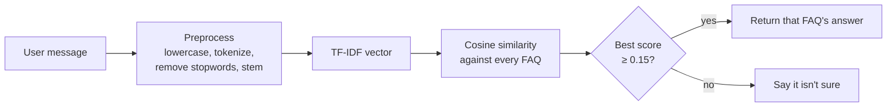

# 🤖 FAQ Chatbot (TF-IDF + Cosine Similarity)

A chatbot that answers questions about a product by matching the user's message against a bank of FAQs. It runs entirely in the browser, with no server, no external API and no ML library.

<!-- Add a screenshot of the chat window here, e.g.:   -->

## How it works



1. **Knowledge base.** Questions and answers live in [`faqs.json`](./faqs.json), pre-loaded with 20 sample FAQs for a fictional "TechGadget" store (shipping, returns, payments, warranty, accounts). Edit this file to use your own topic.
2. **Preprocessing.** Each question and each user message is lowercased, stripped of punctuation, tokenized, cleared of stopwords and lightly stemmed with a simple suffix-stripping stemmer. This mirrors what NLTK or spaCy do in Python, written in plain JavaScript.
3. **Matching.** Each FAQ question becomes a TF-IDF vector, and the user's message is vectorized the same way. Cosine similarity picks the closest FAQ. If the best score is below the **0.15** threshold, the bot says it is not sure instead of guessing.
4. **Chat UI.** `index.html` and `style.css` provide message bubbles, quick-suggestion chips and a text input.

## Run it

`faqs.json` is loaded with `fetch()`, so the page must be served over HTTP. Opening `index.html` directly as a `file://` URL will be blocked in most browsers.

```bash
cd faq-chatbot
python3 -m http.server 8000
# then open http://localhost:8000
```

Any static server works (VS Code Live Server, `npx serve`), and the folder can be deployed to GitHub Pages.

## Use your own FAQs

Edit `faqs.json`, keeping the same shape:

```json
[
  { "q": "What are your shipping options?", "a": "We offer Standard, Express and Same-Day delivery." }
]
```

## Limitations

- Matching is based on shared words, so it does not understand meaning. Rewording a question with different vocabulary can miss.
- It only answers from the FAQ list. Anything outside it gets the "not sure" reply.
- The threshold (`THRESHOLD` in `script.js`) is a single fixed value. Raise it for fewer wrong answers, or lower it for fewer "not sure" replies.

## Python version of the same pipeline

```python
import nltk
from nltk.corpus import stopwords
from nltk.stem import PorterStemmer
from sklearn.feature_extraction.text import TfidfVectorizer
from sklearn.metrics.pairwise import cosine_similarity

nltk.download('punkt'); nltk.download('stopwords')
stop_words = set(stopwords.words('english'))
stemmer = PorterStemmer()

def preprocess(text):
    tokens = nltk.word_tokenize(text.lower())
    return " ".join(stemmer.stem(t) for t in tokens if t.isalnum() and t not in stop_words)

questions = [preprocess(f["q"]) for f in faqs]
vectorizer = TfidfVectorizer().fit(questions)
faq_vectors = vectorizer.transform(questions)

def get_answer(user_input, threshold=0.15):
    user_vec = vectorizer.transform([preprocess(user_input)])
    scores = cosine_similarity(user_vec, faq_vectors)[0]
    best = scores.argmax()
    return faqs[best]["a"] if scores[best] >= threshold else "I'm not sure, could you rephrase?"
```

## Project structure

```
faq-chatbot/
├── index.html   # chat UI markup
├── style.css    # styling
├── script.js    # preprocessing, TF-IDF, cosine similarity, chat logic
├── faqs.json    # editable FAQ knowledge base
└── README.md
```
