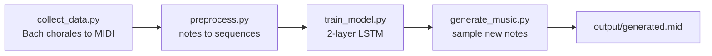

# 🎵 Music Generation with AI

Generates short pieces of music by training a stacked **LSTM** on classical MIDI data, then sampling new note sequences and writing them out as a playable `.mid` file.

<!-- Add a link to a sample generated file here, e.g.:  [Listen to a sample](samples/generated.mid) -->

## How it works



| Step | Script | What it does |
|---|---|---|
| 1. Collect data | `collect_data.py` | Exports public-domain Bach chorales from `music21`'s built-in corpus to `.mid` files. Your own MIDI files work too. |
| 2. Preprocess | `preprocess.py` | Parses every MIDI file with `music21`, extracts notes and chords, builds a vocabulary, and encodes fixed-length input and next-note training sequences. |
| 3. Train | `train_model.py` | Builds a model with two 256-unit LSTM layers, dropout and a dense softmax output in TensorFlow/Keras, trained to predict the next note. |
| 4. Generate | `generate_music.py` | Seeds the model with a real sequence, samples new notes with a temperature setting, and converts the result back to MIDI. |

## Quickstart

```bash
pip install -r requirements.txt

python collect_data.py --n 40            # export 40 Bach chorales as MIDI
python preprocess.py --seq_len 50        # build training sequences
python train_model.py --epochs 100       # train the LSTM
python generate_music.py --n_notes 200   # write output/generated.mid
```

Open `output/generated.mid` in any MIDI player (VLC, GarageBand, QuickTime, or an online player such as onlinesequencer.net), or import it into a DAW.

## Options

| Script | Flag | Default | Purpose |
|---|---|---|---|
| `collect_data.py` | `--n` | 40 | Number of chorales to export |
| `preprocess.py` | `--seq_len` | 50 | Notes of context per training example |
| `train_model.py` | `--epochs` | 50 | Training epochs |
| `train_model.py` | `--batch_size` | 64 | Batch size |
| `generate_music.py` | `--n_notes` | 200 | Length of the generated piece |
| `generate_music.py` | `--temperature` | 1.0 | Randomness of generation (lower is safer, higher is more varied) |

## Quality and training time

- Very short training, such as a 3-epoch test, only proves the pipeline runs and gives close to random output.
- For structured-sounding music, train for 100–200 epochs on a larger dataset (100+ MIDI files). That can take from about 30 minutes on a CPU to a few hours.
- `--seq_len` and `--temperature` are the easiest settings to experiment with.

## Use your own dataset

Skip `collect_data.py` and put your own `.mid` or `.midi` files in `data/midi/`. `preprocess.py` reads every MIDI file in that folder, whatever the genre. Free sources include the [Lakh MIDI Dataset](https://colinraffel.com/projects/lmd/).

## Limitations

- The model predicts one note at a time, so it learns local patterns well but has no sense of the structure of a whole piece.
- The vocabulary is built from the training files, so output is limited to notes and chords the model has seen.

## Project structure

```
music-generation/
├── collect_data.py     # gather MIDI data (music21 corpus)
├── preprocess.py       # MIDI to note sequences
├── train_model.py      # build and train the LSTM (TensorFlow/Keras)
├── generate_music.py   # generate notes and write the output MIDI
├── requirements.txt
├── .gitignore          # data/, models/, output/ are generated, not committed
└── README.md
```

`data/`, `models/` and `output/` are created by the scripts and left out of git, so run the quickstart to recreate them locally.

## License

MIT for the code. The Bach chorales are in the public domain.
