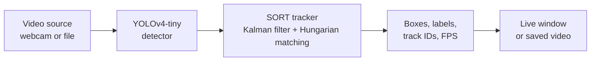

# 🎥 Object Detection & Tracking

Real-time object detection and multi-object tracking in Python. A pre-trained **YOLOv4-tiny** model detects objects, and a **SORT** tracker written from scratch gives each object a stable ID across frames.

<!-- Add a screenshot or GIF of the tracked output here, e.g.:   -->

## How it works



| Step | File | What it does |
|---|---|---|
| 1. Video input | `main.py` | Opens a webcam (`--source 0`) or a video file with `cv2.VideoCapture`. |
| 2. Detection | `detector.py` | Loads YOLOv4-tiny (trained on COCO, 80 classes) through OpenCV's `cv2.dnn` and runs detection plus non-max suppression on each frame. |
| 3. Tracking | `sort_tracker.py` | A compact SORT implementation. A Kalman filter predicts each object's next position, and the Hungarian algorithm (`scipy.optimize.linear_sum_assignment`) matches new detections to existing tracks by IoU. |
| 4. Display | `main.py` | Draws each tracked object's box, class label and persistent ID, and shows live FPS or writes an annotated video. |

**Why YOLOv4-tiny through OpenCV DNN?** It runs on a CPU with a single dependency (`opencv-python`), so there is no PyTorch or CUDA setup. The trade-off is lower accuracy than larger models.

## Quickstart

```bash
pip install -r requirements.txt
bash download_model.sh        # fetches yolov4-tiny.cfg, .weights and coco.names (~24 MB) into models/

# Live webcam with a display window
python main.py --source 0

# A video file
python main.py --source path/to/video.mp4

# Headless: save an annotated video instead of opening a window
python main.py --source path/to/video.mp4 --headless --output output/tracked.mp4
```

Press `q` to quit the live window. `sample_media/` contains a test image and a short test video to try it with.

## Options

| Flag | Default | Purpose |
|---|---|---|
| `--source` | `0` | Webcam index or path to a video file |
| `--conf` | `0.4` | Detection confidence threshold. Lower gives more, noisier detections. |
| `--detect_every N` | `1` | Run the detector every N frames and let the Kalman filter predict in between, for speed on slower machines |
| `--headless` | off | No window; write the output video instead |
| `--output` | none | Path for the annotated video |

The tracker itself, `Sort(max_age, min_hits, iou_threshold)` in `sort_tracker.py`, controls how long a lost object is kept, how many hits confirm a track, and how much overlap counts as the same object.

## Limitations and next steps

- Tracking uses box overlap (IoU) only, so IDs can switch when objects cross paths or are hidden for several frames. **Deep SORT**, which adds appearance features, would help.
- YOLOv4-tiny trades accuracy for speed. **YOLOv8** (`pip install ultralytics`) is the natural upgrade for the detector in `detector.py`.
- The model files are downloaded by `download_model.sh` and are not stored in the repository.

## Project structure

```
object-detection/
├── main.py              # video input, drawing, display or output
├── detector.py          # YOLOv4-tiny detection via OpenCV DNN
├── sort_tracker.py      # Kalman filter + Hungarian-algorithm SORT tracker
├── download_model.sh    # fetches the pre-trained model files
├── sample_media/        # test image and test video
├── requirements.txt
└── README.md
```

## Credits

YOLOv4-tiny weights, config and class names come from the [AlexeyAB/darknet](https://github.com/AlexeyAB/darknet) project. The code in this folder is MIT licensed.
