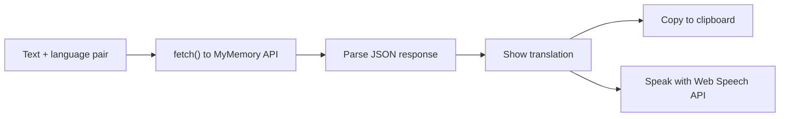

# 🌐 Language Translator

A browser-based translation tool. Type some text, choose a source and target language, and get an instant translation, with copy-to-clipboard and text-to-speech.

<!-- Add a screenshot here, e.g.:   -->

## Features

- 24 languages, with a one-click swap between source and target
- Live character counter, with input limited to 500 characters
- Translation through the free [MyMemory Translation API](https://mymemory.translated.net/doc/spec.php), with no API key required
- 📋 Copy the translation to the clipboard
- 🔊 Listen to the translation using the browser's built-in Web Speech API
- Plain HTML, CSS and JavaScript, with no build step

## How it works



`script.js` holds the language list, builds the API request from the chosen language pair, shows the translated text, and handles the copy and speech buttons.

## Run it

No install needed.

1. Clone or download this folder.
2. Open `index.html` in any modern browser.

Or serve it locally:

```bash
python3 -m http.server 8000
# then open http://localhost:8000
```

## Limitations

- The free MyMemory API has a short per-request length and a daily usage limit, which is why input is capped at 500 characters.
- Translation quality is that of the free service. For production use you would switch to a paid API.
- Text-to-speech depends on the voices installed in your browser, so some languages may not play.

## Using a different translation API

To switch to Google Cloud Translation or Microsoft Translator:

1. Get an API key from the provider.
2. In `script.js`, replace the `fetch(url)` call inside `translate()` with a request to that provider's endpoint.
3. Update the response parsing to match the new JSON shape.

⚠️ Never commit a real API key to a public repository. Call the provider from a small backend and keep the key in an environment variable.

## Project structure

```
translator/
├── index.html    # UI markup
├── script.js     # language list, API call, copy and speech logic
└── README.md
```
